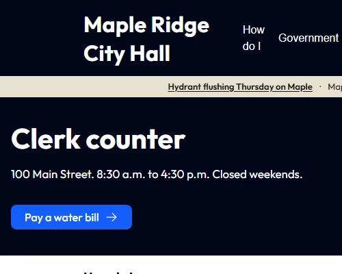

# CivicHall

Designed for clerks and one-person IT shops. How do I, departments, meetings, news, city alerts, search, and a contact form on Drupal CMS.

Maple Ridge sample: 100 Main Street, clerk counter 8:30 a.m. to 4:30 p.m. Change the name after you install.



## Who this is for

City comms or a one-person IT shop. Also useful if you need a municipal demo on Drupal CMS instead of LocalGov Drupal.

## What it installs

Content types: How do I, Department, Official, Meeting, News release, City alert.

Main menu: How do I, Government (Departments, Mayor & Council), Meetings, News, Contact.

Pages:

- `/home` (front page)
- `/how-do-i`
- `/departments`
- `/officials`
- `/meetings`
- `/news`
- `/government`
- `/form/contact-form`
- `/form/report-pothole`
- `/form/public-records-request`
- `/404`

Default theme is CivicHall (`civic_hall_theme`), a Mercury subtheme. Header has the main nav, a search icon (Drupal CMS search at `/search`), a Pay a water bill link, and the city alert strip (same bar on every page). Home is a Canvas page: navy intro, How do I, meetings, news. Listing pages are a 3-column card grid. Listing card titles are h2 in the HTML. On a phone, Pay sits in the navy row with the wordmark, search, and hamburger.

Drupal.org can host a contrib theme project and a Recipe project. Drupal CMS will not add CivicHall to the first-party installer catalog or replace Mercury just because these packages exist.

It also pulls in the usual Drupal CMS pieces (media, search, contact form, SEO). CivicHall types get a `search_index` view mode so Search API can find them. Drupal CMS indexes on save (`index_directly`) and during cron (`automated_cron`). A clerk should not need to run `search-api-index` after a normal install.

## Install

Needs DDEV 1.25+. Pick CivicHall on the template screen after launch.

Composer packages: `drupal/civic_hall` (this recipe) and `drupal/civic_hall_theme` (Mercury subtheme). Use `^` constraints (`^1.0` for the theme). Drupal.org packaging can lag a new tag; if Composer cannot see the version yet, wait or use the path repos below.

The theme is on Drupal.org. The recipe package is not on packages.drupal.org yet. From a local recipe clone, add that path repo **before** launch, then pick CivicHall the same way:

```shell
mkdir maple-ridge && cd maple-ridge
ddev config --project-type=drupal11 --docroot=web
ddev composer create-project drupal/cms
ddev composer repository add civic_hall path /path/to/civic_hall
ddev composer require drupal/civic_hall:@dev
ddev launch
```

If the theme tarball is also missing, add its path repo too:

```shell
ddev composer repository add civic_hall_theme path /path/to/civic_hall_theme
```

On Windows, use the URL from `ddev describe` if the `.ddev.site` name does not resolve.

## After install

Maple Ridge stays until you change it. Do this from the UI.

1. Theme: Appearance. Default is CivicHall (Mercury subtheme, Composer package `drupal/civic_hall_theme`). Drupal.org hosting for that theme and this recipe is contrib, not the default CMS catalog. Packaging can lag a new git tag.
2. Site name: Configuration → System → Basic site settings. The header wordmark and the footer name come from that field (branding block). A clerk changes the city name here. Do not type the city name into a second Canvas heading.
3. Slogan is on the same form. Mercury does not print it in the header or footer, so put the street on the two Canvas lines below.
4. Home hours: edit the `/home` Canvas page. Navy intro heading is “Clerk counter.” The line under it is the street and hours (100 Main Street in the demo).
5. Footer hours: edit the Canvas footer. Under the “City Hall” heading is street, counter hours, and phone. Bottom right still says “Maple Ridge sample site. Not a real city.” Rewrite or delete that.
6. Pay: Canvas header, the button in the navbar links slot. Demo label is “Pay a water bill” and it goes to `/how-do-i/pay-a-water-bill`. Point it at your payment URL or remove the button.
7. Sample nodes: Content. Unpublish Maple Ridge pages when you have real copy, or edit them in place. Listings follow published nodes. Alerts are `city_alert` nodes in the thin header strip. Listing card titles on How do I, Departments, Officials, Meetings, and News are h2 because the CivicHall theme honors the card Level field (already set to 2 on each Canvas content template). Home section cards stay h3 when Level is 3. Pay is in the navy row on a phone because the theme prints that slot outside the hamburger overlay.
8. Contact: `/form/contact-form`. This is the Drupal CMS contact webform, not a Canvas page. The intro (100 Main Street, clerk counter 8:30 a.m. to 4:30 p.m., phone) and the shortcuts (Pay a water bill, Report a pothole, Departments, Meetings) are the first element on that form. Edit them at Structure → Webforms → Contact. Mail goes to the site email on Basic site settings (`admin@example.com` until you change it). To send somewhere else, edit the Contact webform email handler.
9. Sample forms: Report a pothole is `/form/report-pothole`. Public records is `/form/public-records-request`. Edit the labels and the “what happens next” text at Structure → Webforms. Mail uses the site email until you change each form’s email handler.
10. Photos: open `/home` in Canvas, select Clerk counter (Hero CTA), add or replace Background image. Overlay opacity is the scrim. Empty is solid navy. Featured image on a department, news, or official node is a different slot on that page.
11. Labels and photo alt: edit the field title on Structure → Webforms, or the Alternative text on the media/node form. Header search label is the exposed Search filter on the Search view. This is not a 508 certificate.

Site templates do not get updates. After you change things, this recipe is just history.

## Gaps

Mercury’s navbar does not show child links in the mobile overlay. Government is the fallback page for Departments and Mayor & Council.

Meetings do not have agenda/minutes file fields. Paste a PDF link in the body or add a file field.

Tugboat preview is wired but has not been run from this machine. It will need a published `drupal/civic_hall_theme` (or the theme path repo) before it can resolve the recipe.

## Issues

Theme issues: https://www.drupal.org/project/issues/civic_hall_theme

Recipe issues stay in this repo until the Drupal.org recipe project exists.
